<div align="center">


# S.T.A.L.K.E.R. COMMANDER

**A complete graphical front-end for installing, updating, managing and launching S.T.A.L.K.E.R. Anomaly modpacks,
like GAMMA and ROMEO, on Windows, Linux and the Steam Deck.**

<a href="https://github.com/SSH-Kitty/STALKER-GAMMA-COMMANDER/releases/latest"></a>
<a href="https://github.com/SSH-Kitty/STALKER-GAMMA-COMMANDER/releases"></a>


<br>

<a href="LICENSE"></a>
<a href="https://discord.gg/6A9psrtYhh"></a>

<a href="https://github.com/SSH-Kitty/STALKER-GAMMA-COMMANDER/releases/latest"></a>
&nbsp;
<a href="https://github.com/SSH-Kitty/STALKER-GAMMA-COMMANDER/releases/latest"></a>
<br>
<a href="https://discord.gg/6A9psrtYhh"></a>

<a href="#what-this-is"></a>
<a href="#installation"></a>
<a href="#first-run"></a>
<a href="#windows-and-linux"></a>
<a href="#whats-new-in-140"></a>
<a href="#romeo"></a>
<a href="#features"></a>
<a href="#steam-deck-mode"></a>
<a href="#credits"></a>
<a href="https://discord.gg/6A9psrtYhh"></a>

</div>

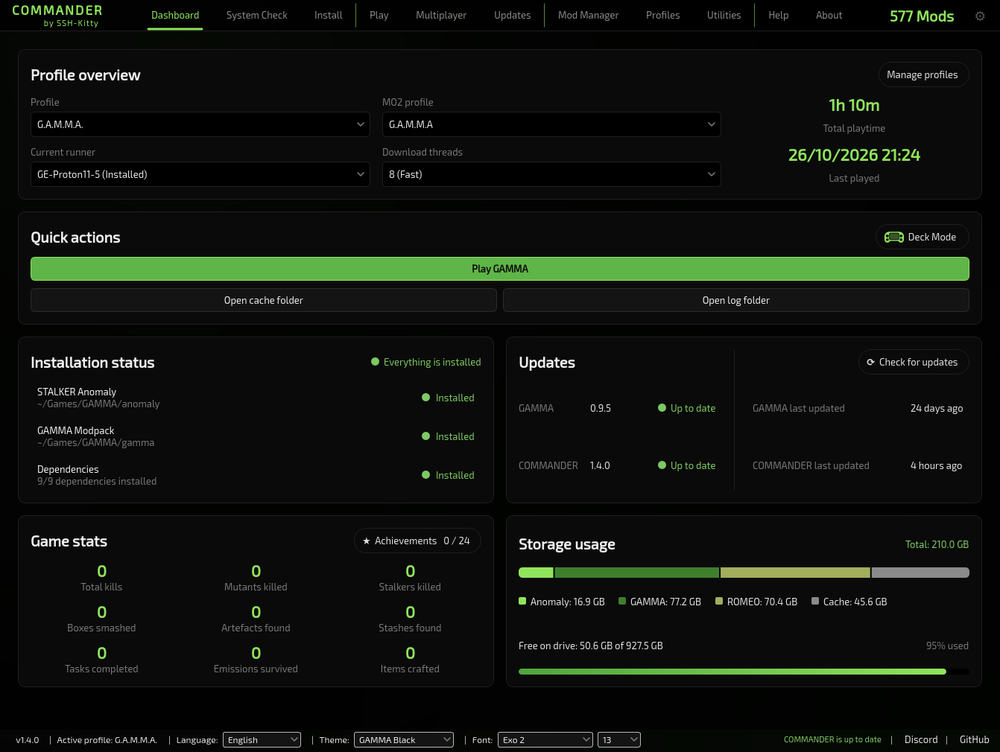

> [!TIP]
> **COMMANDER 1.4.0 is out, now for Windows too.** ROMEO support, xrRazom co-op, a five-step install wizard, a redesigned
> Updates page, settings that survive every update, Steam-style launch options, frame generation and Live themes.
> [See what's new](#whats-new-in-140).

## What this is

S.T.A.L.K.E.R. Anomaly modpacks come with a Windows launcher and run through Mod Organizer 2. Installing them by hand
means many downloads, folders and settings to get right. **COMMANDER does all of it in one app, on Windows, Linux and
the Steam Deck**, from the first install to playing.

| Modpack | Support |
|---|---|
| **[GAMMA](https://github.com/Grokitach/Stalker_GAMMA)** | Install, update, verify, repair, mod and play. |
| **[ROMEO](https://clikrad-com.l.ink/)** | Install, update and uninstall CLIKRΔD's repack on top of GAMMA. |
| More | Other modpacks will be added. |

GAMMA is installed with [FaithBeam/stalker-gamma-cli](https://github.com/FaithBeam/stalker-gamma-cli), which COMMANDER
bundles and runs, so an install made with COMMANDER is the same as one made with the CLI by hand.

Around the install, COMMANDER adds: launching through Mod Organizer 2, a mod manager, dependency setup, integrity checks
and repair, backups and xrRazom co-op. On Linux it also runs everything in a Wine or Proton prefix, installs Proton-GE
and has a full Steam Deck Mode. See [Windows and Linux](#windows-and-linux) for what differs between the two.

## Installation

### Windows: installer (recommended)

Download `COMMANDER-Installer-<version>.exe` from
[**Releases**](https://github.com/SSH-Kitty/STALKER-GAMMA-COMMANDER/releases/latest) and run it. It needs Windows 10
(version 1809 or newer) or Windows 11, 64-bit, and no administrator rights: by default it installs for your user only.

Python, Qt, the CLI and 7-Zip are all bundled. Setup adds a Start menu entry and, if you want, a desktop shortcut.
The installed version **updates itself**: it offers new versions when it starts, checks them against the published
checksum, runs the new Setup and restarts COMMANDER.

Uninstalling it (**Settings → Apps** or **Control Panel → Programs**) also takes back what COMMANDER changed in
Windows: the graphics card choice for the game, its Steam shortcut and, after asking, the Defender exclusions for your
game folders. It asks whether to delete COMMANDER's settings and backups too, and never deletes your game, saves or
mods.

> [!NOTE]
> COMMANDER isn't code-signed, so Windows SmartScreen may say it "protected your PC". Click **More info → Run
> anyway**. To check the file first, compare its checksum with the `.exe.sha512sum` file from the release:
>
> ```powershell
> (Get-FileHash -Algorithm SHA512 .\COMMANDER-Installer-*.exe).Hash.ToLower()
> ```
>
> On Windows 11, **Smart App Control** blocks programs that aren't code-signed and offers no "Run anyway". That can
> stop COMMANDER, Mod Organizer 2 or the game from starting. COMMANDER tells you when it's on; to turn it off, open
> **Windows Security → App & browser control → Smart App Control settings**.

### Windows: portable zip

Prefer not to install? Download the **COMMANDER Portable** zip, unpack it anywhere and start `COMMANDER.exe` (the
`data` folder next to it holds the rest of the app). The portable version tells you about new releases but doesn't
update itself. To check it, compare `COMMANDER.exe` with the `COMMANDER.exe.sha512sum` file inside the zip:

```powershell
(Get-FileHash -Algorithm SHA512 .\COMMANDER.exe).Hash.ToLower()
```

### Linux: AppImage (recommended)

Download the latest `.AppImage` from [**Releases**](https://github.com/SSH-Kitty/STALKER-GAMMA-COMMANDER/releases/latest):

```bash
chmod +x STALKER-GAMMA-COMMANDER-*-x86_64.AppImage
./STALKER-GAMMA-COMMANDER-*-x86_64.AppImage
```

Python, Qt and the CLI are all bundled inside. The AppImage **updates itself**: it offers new versions when it starts,
checks them against the published checksum, and restarts. Each release also has a `.sha512sum` file:

```bash
sha512sum -c STALKER-GAMMA-COMMANDER-*-x86_64.AppImage.sha512sum
```

### Linux: Arch Linux

A `PKGBUILD` is provided under [`packaging/aur/`](packaging/aur/):

```bash
git clone https://github.com/SSH-Kitty/STALKER-GAMMA-COMMANDER.git
cd STALKER-GAMMA-COMMANDER/packaging/aur
makepkg -si
```

### Linux: from source

```bash
git clone https://github.com/SSH-Kitty/STALKER-GAMMA-COMMANDER.git
cd STALKER-GAMMA-COMMANDER
./run.sh
```

`run.sh` creates a `.venv/`, installs PySide6 and starts COMMANDER. The `stalker-gamma` CLI is already bundled. Add
`--deck` to start in [Steam Deck Mode](#steam-deck-mode).

### Unstable builds

Want new features before they reach a release? Select **Try the unstable build** under **Settings → General →
COMMANDER build**. Unstable builds are less tested; **Go back to the stable build** returns you at any time. On
Windows this needs the installed version; the portable zip stays on the build you downloaded.

## First run

### Windows

1. **Install** → COMMANDER opens here until GAMMA is installed. Follow the wizard: pick a drive or folder (COMMANDER
   makes a `GAMMA` folder in it), install the Visual C++ and DirectX runtimes, then Anomaly and GAMMA. Expect a large
   download: about 150 GB, or about 100 GB with Minimal.
2. **Play** → press **Launch Game**.

### Linux and Steam Deck

1. **System Check** → install anything shown as missing with the copy-command button.
2. **Install** → follow the wizard: pick a folder, install dependencies, then Anomaly and GAMMA. Expect a large
   download: about 150 GB, or about 100 GB with Minimal.
3. **Play** → keep the runner on Auto-detect and press **Launch Game**. The first start is slow while shaders are
   built.

Already installed GAMMA with the CLI, on Windows, or from GOG? COMMANDER can use that install. Use **Updates** for
updates afterwards, and **Verify Integrity** if something seems broken.

## Windows and Linux

COMMANDER is one app with the same pages on both systems. On Windows the game runs natively, so everything that
exists only to run it through Wine or Proton is left out.

| | Windows | Linux |
|---|---|---|
| **Runs the game** | Natively, through Mod Organizer 2 | Through Mod Organizer 2 in a Wine or Proton prefix |
| **Dependencies** | Visual C++ and DirectX runtimes, installed by COMMANDER | `umu-run`, `winetricks` and eight runtimes in the prefix |
| **System Check page** | Not needed | Checks Wine, Vulkan, Proton-GE, GameMode and more |
| **Runner and Proton-GE installer** | Not needed | Yes |
| **Frame generation** | Starts the [Lossless Scaling](https://store.steampowered.com/app/993090/Lossless_Scaling/) app with the game | Bundled layer using `Lossless.dll` |
| **Launch options, MangoHud, vkBasalt, in-game graphics overlay** | Linux only | Yes |
| **Install, Updates, Verify and Repair, Mod Manager, Profiles** | Yes | Yes |
| **xrRazom co-op, ROMEO, ModDB plugin** | Yes | Yes |
| **Add to Steam, desktop shortcuts, tray icon** | Yes | Yes |
| **Steam Deck Mode** | Linux only | Yes |
| **Self-update** | Installed version | AppImage |

## What's new in 1.4.0

Everything added since the last stable release, **1.3.1**.

#### Windows

- **COMMANDER now runs on Windows.** The same app, running the game natively with no Wine or Proton.
- **Installer or portable zip.** A Setup that needs no administrator rights and updates itself, or a zip you
  unpack anywhere.
- **Visual C++ and DirectX runtimes** are found and installed by COMMANDER, during Setup or from the Install page.
- **Frame generation through Lossless Scaling**, started with the game from the Play page.
- **Add to Steam, desktop shortcuts, tray icon, co-op, ROMEO and the ModDB plugin** all work on Windows.
- **ASSISTANT explains Windows crash codes** in plain words.
- **Windows extras.** Installs and updates keep the PC awake and show their progress on the taskbar button.
  On laptops with two graphics cards, the game runs on the faster one. COMMANDER warns before you install into
  OneDrive, and explains when Smart App Control or an antivirus blocks a program.
- **Log dumps on Windows** include the crash reports Windows itself keeps for the game, MO2 and COMMANDER, and the
  Windows settings that matter to GAMMA (page file, Smart App Control, runtimes and more). ASSISTANT tells you
  whether the game crashed in the graphics driver, an overlay or the engine.

#### Modpacks and co-op

- **xrRazom co-op.** A new **Multiplayer** page with guided install, one-step switching between co-op and
  singleplayer, Steam or LAN sessions, host settings, and a **Mod check** to compare mod lists with friends.
- **Co-op for Anomaly, GAMMA and ROMEO.** Play xrRazom co-op on plain Anomaly, GAMMA or ROMEO, and switch
  between them.
- **Co-op Steam shortcut** with its own artwork and an animated loading screen.
- **ROMEO support.** Install, update and uninstall CLIKRΔD's ROMEO repack on top of GAMMA, with its own MO2 profile.
- **Modded exes.** A new option to update GAMMA's modded engine executables.
- **Plugins.** COMMANDER can now load plugins. The first one is a **ModDB browser** for finding and downloading mods
  inside COMMANDER.

#### Install

- **Five-step install wizard**: Folder, Dependencies, Anomaly, GAMMA, Verify.
- **Resumes after closing COMMANDER**, reopens on the right step, and replaces broken archives in the cache by itself.
- **Your setup survives installs and updates.** Your mod choices, your own mods, MO2's settings and each executable's
  arguments are put back, and your own mods keep their place.
- **Windows installs.** Open a GAMMA install from Windows, or copy one from a Windows drive to Linux.
- **Offline install** from an offline cache archive (keep the archive until the install is done: CLI 1.41 unpacks it
  itself), and a **faster Anomaly download** from a mirror.
- **Reinstall Anomaly** button, a **Switch install** card, and install folders moved to **Settings → Game**.
- **Steam Machine** support with its own Help guide. Protontricks is no longer needed.

#### Updates and repair

- **Redesigned Updates page** with patch notes for every release you missed, a clear list of mod changes, and
  **Resume update**.
- **GOG installs** now get update checks: COMMANDER rebuilds GAMMA's modpack list.
- **Verify Integrity** checks GAMMA's own files against its repos, and repairs reuse cached archives.
- **Mod list backup before every launch**, with a restore prompt if every mod has been turned off.

#### Playing

- **Frame generation** with a bundled open-source layer. It needs `Lossless.dll` from
  [Lossless Scaling](https://store.steampowered.com/app/993090/Lossless_Scaling/) (paid, on Steam), which COMMANDER finds
  for you.
- **MangoHud and vkBasalt built in.** Performance overlay and image effects, with changes applied in a running game.
- **Graphics overlay over the game**: press **Shift+`** to change frame generation, the overlay and image effects
  while you play. A pop-up tells you when an effect is switched on or off.
- **Launch options overhaul.** Steam-style `%command%` launch options and quick toggles, including **NTSync** and
  **Debug mode**.
- **Crash loop detection** and **Analyze crash**, which opens the logs in ASSISTANT.

#### Steam Deck Mode

- **Catches up with the desktop**: change the active profile, a Graphics screen with frame generation, the in-game
  overlay on the back grips (**L4 + R4**), Help, co-op, ROMEO, modded exes and self-update.
- **Multiplayer** in Deck Mode.

#### Look and feel

- **Live themes**: **Red Forest** and **Winter**, which follow the time of day.
- **System tray icon**: hide to the tray, a quick menu, and start in the tray at login.
- **COMMANDER's own file picker and right-click menus**, so right-click works on Wayland.
- **Notification buttons**, click sounds, themed and shorter tooltips, and click the version number to copy debug
  info.
- **Fits narrow and tiling windows**, with cards that stack and glide into place, and faster page switches.
- **Steam library artwork** for every COMMANDER shortcut.
- **Help and About pages** with the complete documentation, credits and licences.
- **Stable and unstable builds** you can switch between in Settings.

#### Under the hood

- **stalker-gamma-cli 1.36.1 → 1.41.1**: much faster updates (only changed files are extracted), faster unpacking,
  timestamped update logs, and no more `unzip` or `tar` needed.
- Downloads without a known size show MB instead of a wrong percentage.
- Stopping a long job asks first.
- The AppImage bundles Python 3.12.15.
- Log dumps capture more data, and ASSISTANT gives clearer findings.
- Many bug fixes, memory leak fixes and performance improvements.

## Features

### Dashboard

The landing page. Shows the active profile, install status for Anomaly and GAMMA, a live dependency count, storage
across your Anomaly, GAMMA and cache folders, updates, playtime and your achievements.

### Install

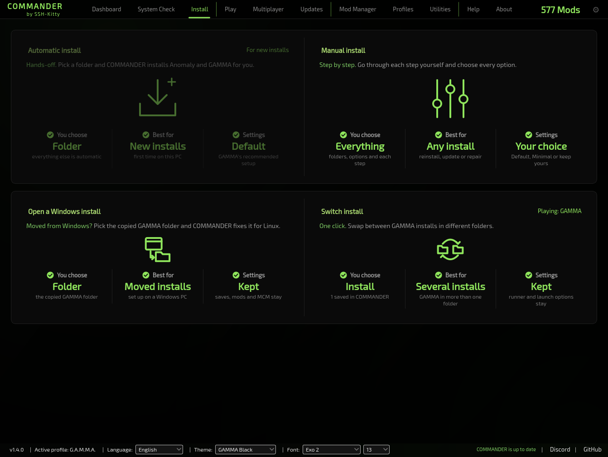

A five-step wizard: **Folder → Dependencies → Anomaly → GAMMA → Verify**, with a live per-addon progress table and an
overall progress bar. Start with GAMMA's recommended setup, or choose every folder and option yourself.

- **Resume where it stopped.** If an install is interrupted, even by closing COMMANDER, the next start offers **Resume
  GAMMA Installation**. Cached archives are checked and reused, mods already unpacked are skipped, and broken
  archives are replaced by themselves.
- **Install Dependencies** sets up everything MO2 and the game need in one click. On Windows, that's the Visual C++
  and DirectX runtimes. On Linux, it's `umu-run`, `winetricks` and eight Visual C++ and DirectX runtimes, installed
  through your runner's own Wine so the prefix is never damaged.
- **Faster Anomaly download** from the CLI author's
  [mirror](https://github.com/FaithBeam/stalker-gamma-cli/wiki/Anomaly-Mirror), on by default. ModDB is used if the
  mirror fails.
- **Your setup is kept.** Your mod choices, your own mods (under **Custom Mods**), MO2's settings and each
  executable's arguments come back after every install and update.

| Install option | What it does |
|---|---|
| **Preserve user.ltx** | Keeps your graphics, sound and keybinds. |
| **Preserve MCM settings** | Keeps every mod's settings from the Mod Configuration Menu. |
| **Minimal** | Deletes archives after unpacking to save about 50 GB. |
| **Re-download GitHub addons** | GitHub-hosted archives are reused from the cache unless you tick this. |
| **Keep my current engine executables** | Keeps engine executables you installed yourself, such as newer or modded builds. |
| **Offline install** | Installs from an [offline cache archive](https://github.com/FaithBeam/stalker-gamma-cli/wiki/Offline-Install) without downloading anything. Keep the archive file: a cache you unpacked yourself installs with a normal install instead, which downloads only what's missing. |

### Verify Integrity and Repair

Checks every Anomaly file against its official checksums, checks that every enabled mod is on disk, compares GAMMA's
own files with its git repos, and scans every mod file against a saved snapshot.

If a broken mod is part of the official GAMMA list, COMMANDER can **repair it without losing anything**: the mod
folder is set aside (not deleted), archives that still match are reused from the cache, and anything that fails to
reinstall is put back.

### Play

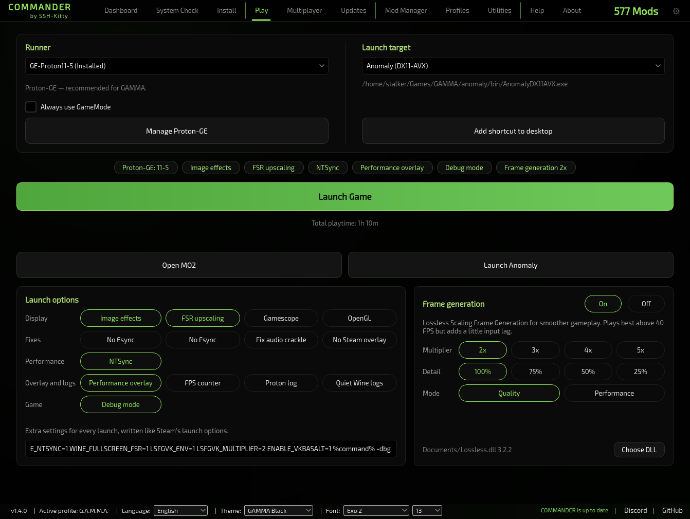

Launch GAMMA through Mod Organizer 2, open MO2 directly, or run Anomaly without mods. Launch targets are read straight
from `ModOrganizer.ini`.

On Windows, the game runs natively, so the page is simpler: launch buttons, frame generation through the
[Lossless Scaling](https://store.steampowered.com/app/993090/Lossless_Scaling/) app (COMMANDER finds it and starts it
with the game), crash help, shortcuts, playtime and Discord Rich Presence. The runner, Proton-GE, launch options and
quick toggles below are for Linux.

- **Auto runner detection.** The newest installed GE-Proton is picked by itself and launched through `umu-run`.
- **Built-in GE-Proton installer.** Browse recent releases, download with progress and cancel, and COMMANDER checks the
  SHA-512 checksum before installing.
- **Steam-style launch options.** `NAME=value` sets an environment variable, words before `%command%` wrap the game
  (for example `mangohud %command%`), and words after it are passed to the game.
- **Quick toggles.** Gamescope, FSR upscaling, vkBasalt, OpenGL, NTSync, No Esync, No Fsync, Fix audio crackle, No
  Steam overlay, MangoHud, an FPS counter, Proton log, Quiet Wine logs and Debug mode (`-dbg`).
- **Frame generation, performance overlay and image effects**, set in **Settings → Graphics**. Changes reach a running
  game right away. Frame generation needs your own copy of
  [Lossless Scaling](https://store.steampowered.com/app/993090/Lossless_Scaling/).
- **Crash help.** Failed launches are explained in plain words. A Wine crash loop is stopped before it uses up your
  memory, and when Anomaly crashes, **Analyze crash** opens the logs in ASSISTANT.
- The game launches **detached**, so closing COMMANDER doesn't close it.
- One-click **desktop shortcuts**, **total playtime** per profile, and optional **Discord Rich Presence**.

### Multiplayer

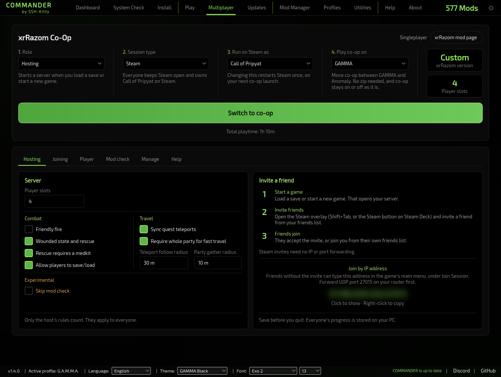

Installs [xrRazom Co-op](https://www.moddb.com/mods/xrrazom-stalker-anomaly-co-op) (Slim edition) and manages it
alongside your singleplayer install.

- **Guided install.** Download the xrRazom archive from ModDB; COMMANDER finds it in Downloads or on the Desktop.
- **One-step switching.** **Switch to co-op** backs up the Anomaly files it replaces and enables the mod. **Switch to
  Singleplayer** puts the originals back. Co-op saves are kept.
- **Safe launches.** With co-op on, only co-op can be launched, and the other way round. Updates ask you to switch back
  first, and **Re-apply co-op** fixes it if an update replaced the engine.
- **Steam or LAN.** Steam sessions use invites through Call of Pripyat if you own it, or Spacewar otherwise.
  COMMANDER creates the co-op Steam shortcut for you. LAN uses an IP address and port.
- **Mod check.** Compare mod lists with friends before joining.
- **Host settings** for player slots, friendly fire, rescue, saving, teleport and fast travel.
- **Stream-friendly.** Your LAN address is blurred on the invite tab.

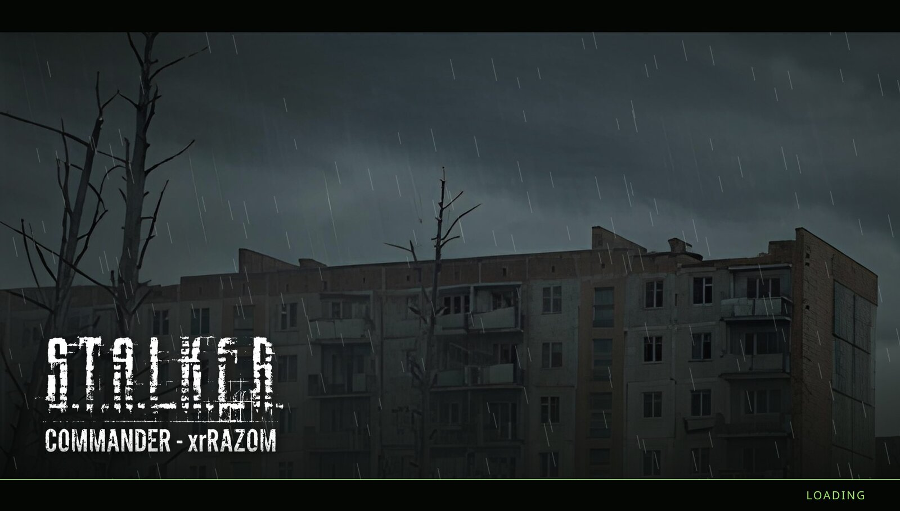

### Updates

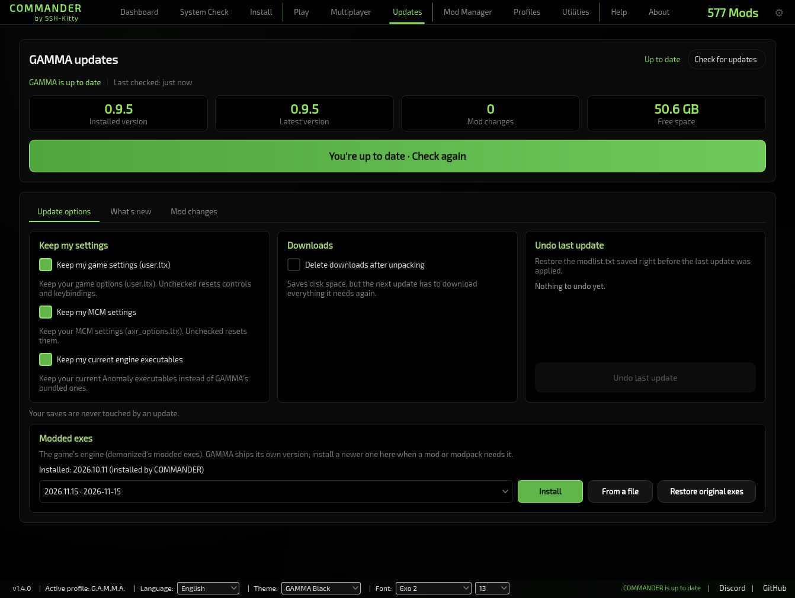

Compares your installed GAMMA version and mod list with the latest official one, without hitting GitHub's
rate-limited API.

- **Every release you missed**, newest first, with releases you haven't installed yet marked **New**.
- **Every mod change**: added, removed and changed addons, or a note that your list matches the official one.
- **Before you update**: installed and latest versions, free space, and **Keep my settings** in one place.
- **Resume update** after a failed or cancelled update, and **Undo last update** to get your mod list back.
- **GOG installs** work too: COMMANDER rebuilds GAMMA's modpack list from the mods present.

### Mod Manager

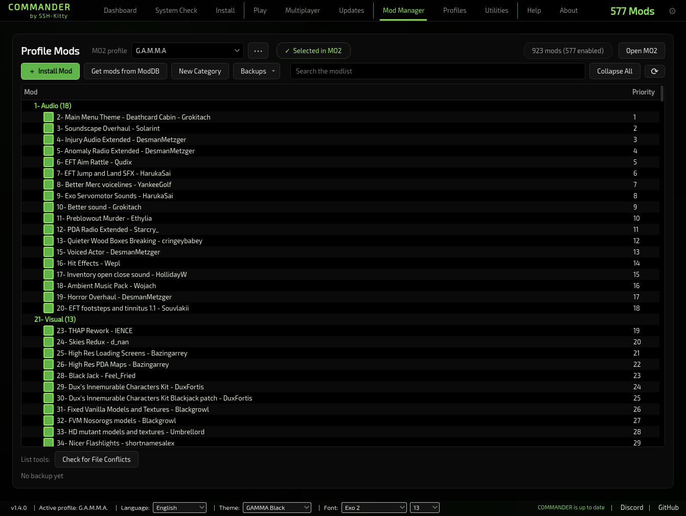

Careful editing of the active MO2 profile's mod list: search, enable, disable, delete and reorder mods, grouped by
GAMMA's categories and shown in the same order as MO2.

- **Drag-and-drop reordering** with multi-selection, plus Move Up and Down.
- **Install your own mods** from ZIP, 7Z, RAR or FOMOD archives, with a step-by-step FOMOD wizard. New mods go into
  **Custom Mods**. **Get mods from ModDB** with the optional ModDB plugin.
- **Reversed load order detection**: a GAMMA load order flipped end to end (which crashes the game) is flagged here and
  before launching, with a one-click fix.
- **Backups before your first edit**, **Restore Original Order**, and every change written safely, so a crash can't
  cut your load order short. Editing is locked while MO2 runs, because MO2 would undo it on exit.
- **Check for File Conflicts** shows which mods override each other.
- Press **Ctrl+F** anywhere to jump to the search box.

### ROMEO

Install [CLIKRΔD's ROMEO repack](https://clikrad-com.l.ink/) on top of GAMMA from the **Mod Manager**. COMMANDER adds ROMEO's mods and its own MO2
profile, so your GAMMA mod list stays as it is, and you can switch between the two. Updating and uninstalling are one
click too.

### Profiles

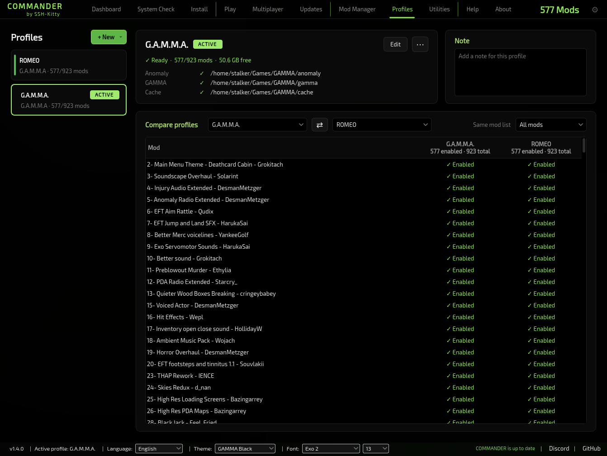

Create, edit, activate and delete profiles, each with its own Anomaly, modpack and cache folders, MO2 profile, download
threads and repositories. Give a profile a colour and a note, compare the mods of two profiles, and **export** a
profile to hand to a friend. Folder paths are never included.

### System Check (Linux)

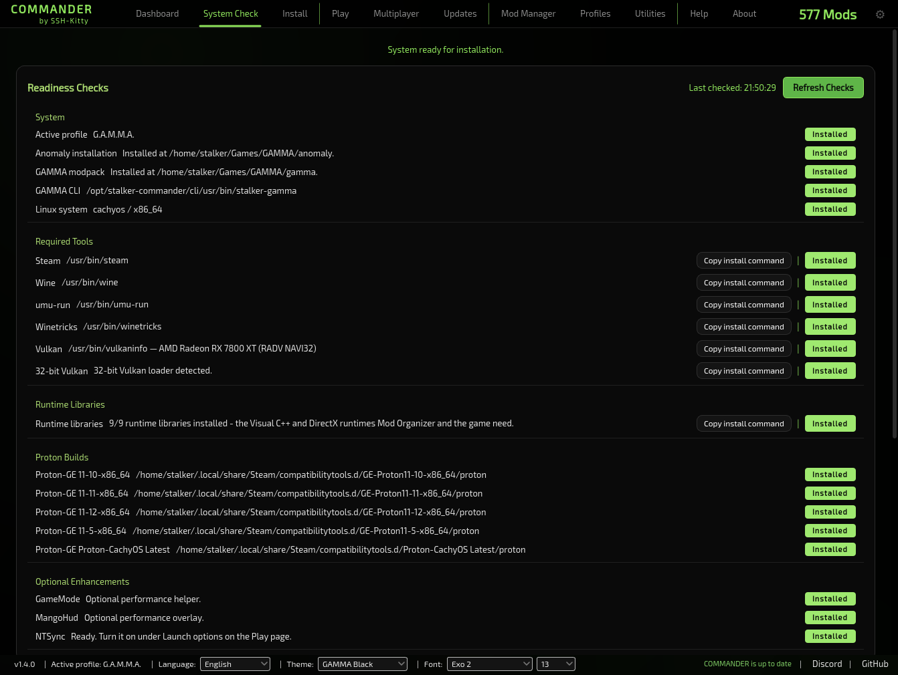

Checks everything the game and MO2 need in one place: the CLI, Wine, Winetricks, `umu-run`, Vulkan (including the 32-bit
loader), each Windows runtime, GE-Proton builds, GameMode, MangoHud and NTSync. For anything missing, it gives you the
exact install command for your distribution. Windows doesn't need this page: the Install page checks the Visual C++
and DirectX runtimes instead.

### Utilities

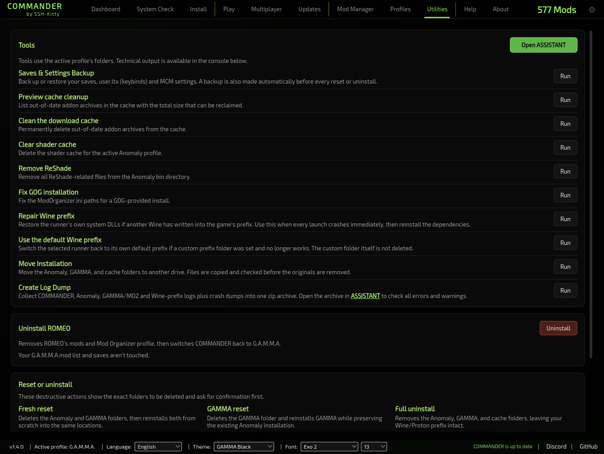

A toolbox for maintenance and recovery:

- **Backups** of your saves, game options, keybinds and MCM settings, also taken automatically before every reset,
  update and repair.
- **Cache cleanup**: see which archives are out of date and how much space they free, then clean them.
- **Clear shader cache** and **Remove ReShade** for a clean slate after driver or mod changes.
- **Fix GOG installation**, and on Linux **Repair Wine prefix**.
- **Move installation** to another drive, verified before the originals are deleted.
- **Fresh Reset**, **GAMMA Reset** and **Full Uninstall**, each showing exactly what will be deleted and what's kept.
  On Linux, your Wine prefix always survives.
- **Create Log Dump** for bug reports, and the bundled **COMMANDER ASSISTANT**, which reads your logs and explains what
  went wrong.

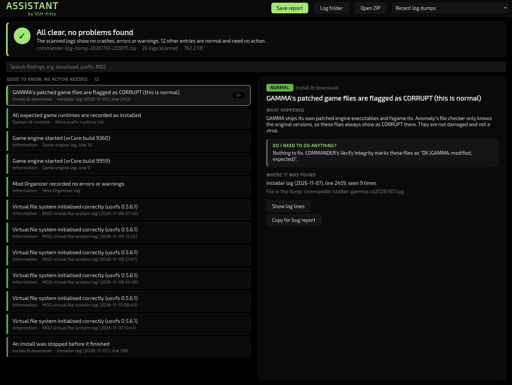

### Settings

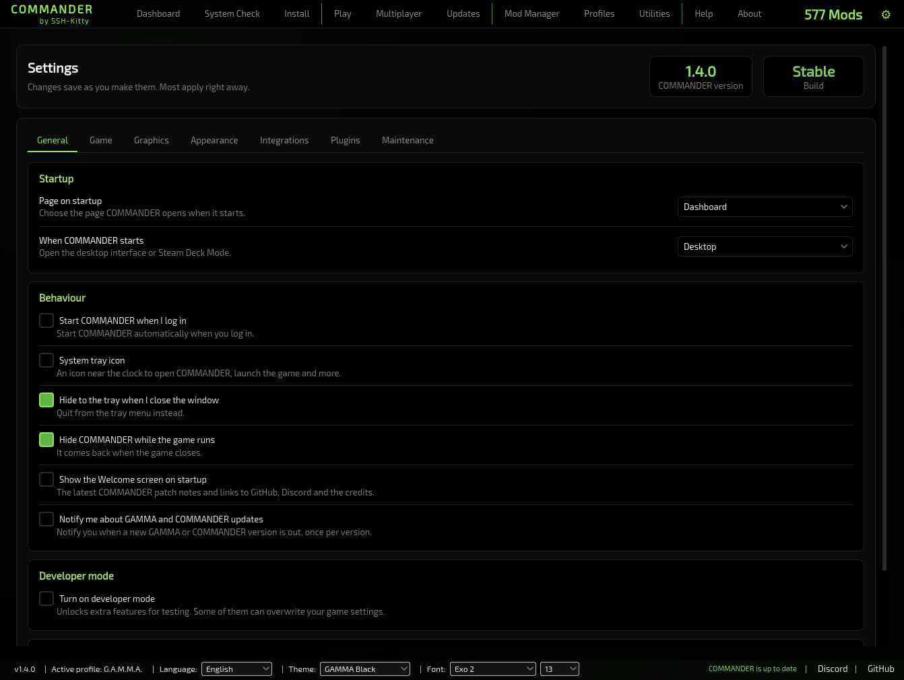

- **10 languages**: English, French, Spanish, German, Romanian, Polish, Russian, Ukrainian, Portuguese and Turkish.
  Switch any time, no restart.
- **8 themes**: GAMMA, GAMMA Black, Dusk, Midnight, Terminal, Reactor, and the **Live** themes Red Forest and Winter,
  which follow the time of day.
- **Graphics** (Linux): frame generation, the performance overlay and image effects.
- **Add COMMANDER to Steam** writes COMMANDER and Deck Mode straight into your Steam library, with cover, background,
  logo and wide artwork.
- **System tray icon**, start at login, update notifications, and **stable or unstable builds**.
- Font and size, startup page and, on Linux, default runner, GameMode and MO2 display scale.

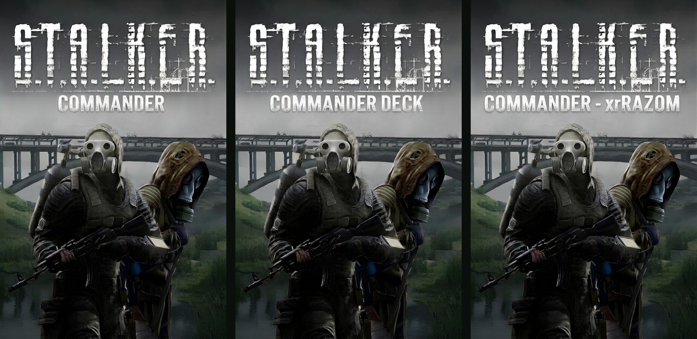

### Help and About

<table>
<tr>
<td width="50%">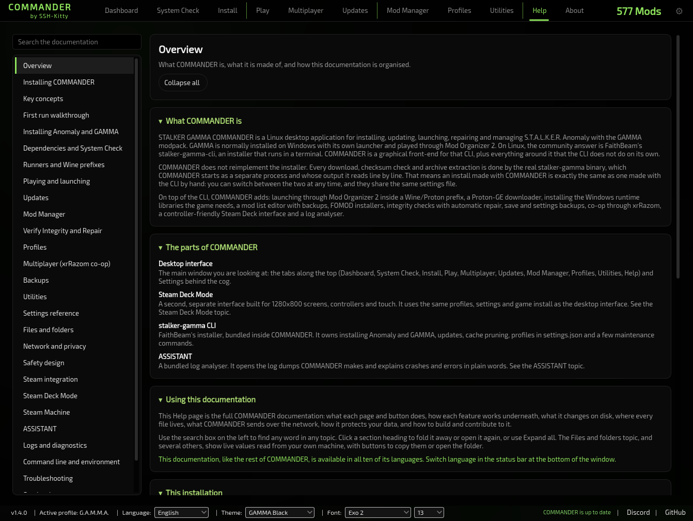</td>
<td width="50%">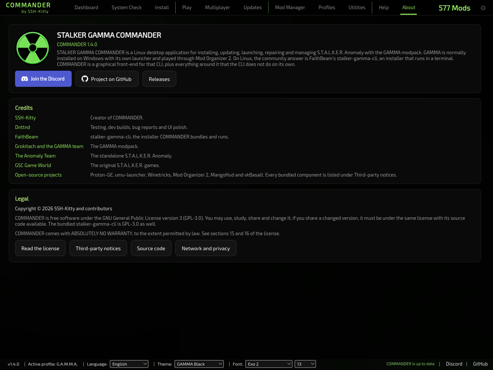</td>
</tr>
</table>

**Help** is a complete, searchable manual covering every page and control, in all ten languages. **About** lists the
credits and every bundled open-source component with its licence.

## Steam Deck Mode

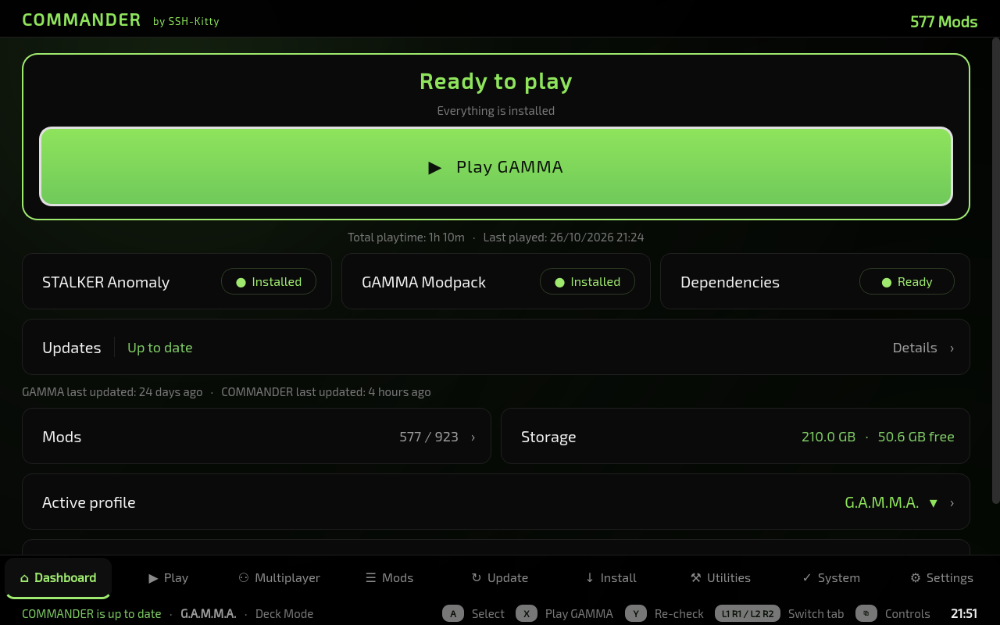

Linux and SteamOS only. A second interface built for the Deck's 1280×800 screen, its controls and its touchscreen. Open it from the Steam Deck
icon on the **Dashboard**: COMMANDER closes and reopens in Deck Mode. **Exit Deck Mode** in Deck Mode's Settings, or
the ☰ Menu button, brings you back.

- **First-run setup.** With no profile yet, Deck Mode asks one question, internal storage or SD card, creates the
  profile and sends you to Install.
- **Tabs**, in handheld order: **Dashboard · Play · Mods · Update · Install · Utilities · System · Settings**.
- **Dashboard** answers "can I play?" in one banner, with the one button that moves things forward (Play, Install,
  Resume, Update), then status, updates, mods, storage and your profiles.
- **Play** has **Force Stop Game** for a game that hangs, since the Deck has no Alt+F4. **Mods** is the full mod list
  with categories, search and FOMOD installs. **Update**, **Install**, **Utilities**, **System** and **Settings** do
  what their desktop pages do.
- **Graphics over the game**: hold **L4 + R4** while playing to change frame generation, the overlay and image
  effects.
- **Handheld-aware.** The Deck stays awake during installs, updates and moves, you're warned before a long download on
  battery, and it chimes and vibrates when a long job finishes.
- **Any screen size.** On a monitor or a TV, the whole interface scales up.

**Controls.** The controller works in Game Mode out of the box with Steam's default layout, and in Desktop Mode too.

| Button | Action |
|---|---|
| D-pad / left stick | Move (hold to repeat) |
| A | Select or toggle. Hold on a mod to move it. |
| B | Back |
| X | The screen's main action (below) |
| Y | The screen's second action, or search |
| L1 / R1 | Previous / next tab |
| L2 / R2 | Page up / down |
| L4 + R4 (held) | Graphics over a running game |
| ☰ Menu | Play GAMMA, Help, Exit Deck Mode or Quit |
| ⧉ View | Controls help |

| Screen | X | Y |
|---|---|---|
| Dashboard | What the banner says (Play / Install / Resume / Update) | Re-check |
| Play | Play GAMMA (Force Stop while running) | Open MO2 |
| Mods | Category menu | Search |
| Update | Check / Apply updates | Show changes |
| Install | Install or resume GAMMA | Install dependencies |
| System | Re-check | — |

Text fields have an on-screen keyboard (Y), touch works everywhere, and every theme and language works as on the
desktop, with its own 80–150% text size. On a real Steam Deck, COMMANDER offers Deck Mode the first time it starts,
and in Game Mode it opens Deck Mode without asking.

> [!IMPORTANT]
> **Adding Deck Mode to Steam.** In Desktop Mode, use **Add COMMANDER to Steam** (desktop **Settings → Steam**, or
> Deck Mode's **Settings**). It writes **STALKER COMMANDER** and **STALKER COMMANDER DECK** into your library and
> restarts Steam. Then start **STALKER COMMANDER DECK** from Game Mode.
>
> Adding it by hand instead? For the AppImage, add the `.AppImage` and set its launch options to `--deck`. For the
> AUR or a source install, add **STALKER COMMANDER (Deck Mode)**.

## Reporting a problem

1. Note your build number under **Settings → General → COMMANDER build**, or click the version in the status bar.
2. Create a log dump with **Utilities → Create Log Dump**.
3. Post both in the [Discord](https://discord.gg/6A9psrtYhh) or as an
   [issue](https://github.com/SSH-Kitty/STALKER-GAMMA-COMMANDER/issues).

## Contributing a translation

Adding a new language needs no code changes: start from
[`commander_gui/locales/template.py`](commander_gui/locales/template.py), which lists every translatable string in the
app, and follow the steps in its header.

## Running the tests

On Linux:

```bash
QT_QPA_PLATFORM=offscreen .venv/bin/python -m pytest tests/ -q
```

On Windows, fetch the Windows CLI and 7-Zip first (they aren't kept in git), then run the tests:

```powershell
python scripts/fetch_windows_cli.py
$env:QT_QPA_PLATFORM = "offscreen"; python -m pytest tests/ -q
```

## Credits

- **[FaithBeam](https://github.com/FaithBeam)**: [`stalker-gamma-cli`](https://github.com/FaithBeam/stalker-gamma-cli),
  the installer COMMANDER runs and bundles.
- **[dnttnd](https://github.com/dnttnd)**: testing, dev builds, bug reports and UI refinement.
- **[Grokitach](https://github.com/Grokitach)** and the GAMMA team: [the modpack itself](https://github.com/Grokitach/Stalker_GAMMA).
- **The Anomaly Team**: the standalone S.T.A.L.K.E.R. Anomaly and its engine.
- **[GSC Game World](https://www.gsc-game.com/)**: the original S.T.A.L.K.E.R. games.

## License

Licensed under the **GNU General Public License v3.0**; see [LICENSE](LICENSE). COMMANDER bundles and runs
`stalker-gamma-cli`, which is GPL-3.0, so COMMANDER is GPL-3.0 as well.

- Copyright for the Python/Qt graphical interface: **SSH-Kitty**

<div align="center">

<sub>Not affiliated with GSC Game World or the teams behind GAMMA, ROMEO or any other modpack.</sub><br>
<sub><i>Good hunting, stalker.</i></sub>

</div>
